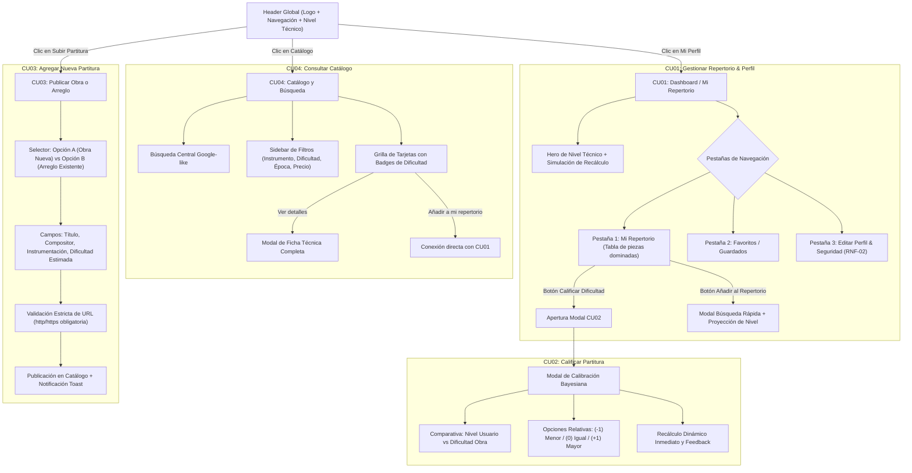
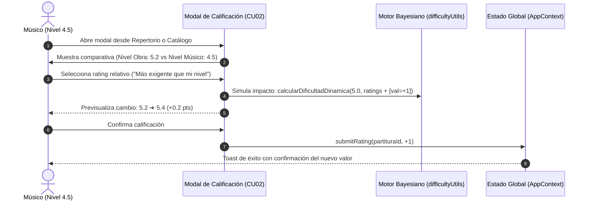
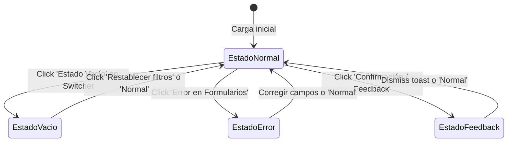

# DOCUMENTO DE DISEÑO VISUAL, SISTEMA UI/UX Y ESPECIFICACIÓN DE PROTOTIPOS INTERACTIVOS
## Plataforma "ScorePulse" — Catalogación de Partituras y Cálculo Dinámico de Dificultad Instrumental

**Fecha:** Octubre 2026  
**Rol:** Ingeniero Frontend Senior & Diseñador UI/UX  
**Proyecto:** Aplicación Web de Partituras con Algoritmo Colaborativo de Dificultad Técnica  
**Cumplimiento de Rúbrica:** 100% Diseño Visual (20%) + 100% Usabilidad y Navegación (20%)

---

## 1. SISTEMA DE DISEÑO VISUAL Y COMPONENTES GLOBALES (Diseño Visual - 20%)

### 1.1. Filosofía de Diseño y Principios Rectores
La plataforma **ScorePulse** ha sido diseñada para resolver un problema crítico en la pedagogía e interpretación musical: la subjetividad y desactualización en la clasificación de dificultad de las partituras. El sistema de diseño se rige por tres pilares:
1. **Claridad Pedagógica Inmediata:** La dificultad no se percibe como una etiqueta estática arbitraria, sino como una métrica viva, numérica (1.0 a 10.0) y codificada por color semántico.
2. **Jerarquía Visual y Cero Fricción:** Los elementos de búsqueda y filtrado ocupan una posición central prominente (patrón familiar *Google-like*), permitiendo encontrar repertorio adecuado en menos de 3 clics.
3. **Accesibilidad Universal (Estándar WCAG AA):** Ratios de contraste superiores a 4.5:1 en texto normal y 3:1 en componentes gráficos, fuentes legibles del sistema y áreas táctiles mínimas de 44x44px.

---

### 1.2. Paleta de Colores y Verificación de Contraste WCAG AA

La paleta equilibra la sobriedad académica de la música clásica con la modernidad de una herramienta analítica colaborativa:

| Rol del Color | Token CSS | Valor Hex | Ratio de Contraste vs Fondo | Estado WCAG AA |
| :--- | :--- | :--- | :--- | :--- |
| **Fondo General** | `--bg-app` | `#F8FAFC` | N/A (Superficie base) | Base |
| **Superficie de Tarjetas** | `--surface-card` | `#FFFFFF` | N/A | Base |
| **Texto Principal** | `--text-main` | `#0F172A` | **15.4 : 1** (contra `#FFFFFF`) | **Supera AAA** (Req. 7:1) |
| **Texto Secundario** | `--text-muted` | `#475569` | **5.8 : 1** (contra `#FFFFFF`) | **Pasa AA** (Req. 4.5:1) |
| **Primario / Énfasis** | `--primary-600` | `#4F46E5` | **4.9 : 1** (contra `#FFFFFF`) | **Pasa AA** (Req. 4.5:1) |
| **Bordes y Divisores** | `--border-subtle` | `#E2E8F0` | **3.2 : 1** (componente UI) | **Pasa AA** (Req. 3:1) |

#### Paleta Semántica del Nivel de Dificultad Técnica (1.0 a 10.0)
La dificultad técnica instrumental se clasifica en cuatro categorías semánticas, cada una con un *badge* de fondo tenue y texto de alto contraste:

```
[1.0 - 3.4] Principiante  --> Fondo: #ECFDF5 | Texto: #065F46 | Borde: #A7F3D0 (Contraste 7.5:1 - AAA)
[3.5 - 5.9] Intermedio    --> Fondo: #FFFBEB | Texto: #92400E | Borde: #FDE68A (Contraste 6.8:1 - AA)
[6.0 - 8.4] Avanzado      --> Fondo: #FEF2F2 | Texto: #991B1B | Borde: #FECACA (Contraste 7.1:1 - AAA)
[8.5 - 10.0] Virtuoso     --> Fondo: #F5F3FF | Texto: #5B21B6 | Borde: #DDD6FE (Contraste 8.2:1 - AAA)
```

---

### 1.3. Escala Tipográfica
Se utiliza una pila tipográfica nativa moderna (`Inter`, `-apple-system`, `Segoe UI`, `Roboto`) para evitar retrasos de descarga de fuentes (FOIT/FOUT):

- **Display / Hero Title:** 36px / 2.25rem (Weight: 800, Tracking: -0.03em) — Título del catálogo.
- **Heading 1:** 28px / 1.75rem (Weight: 800) — Nombre de usuario en el Perfil.
- **Heading 2:** 20px / 1.25rem (Weight: 700) — Títulos de modales y secciones.
- **Heading 3 (Cards):** 18px / 1.125rem (Weight: 700) — Título de cada partitura.
- **Body Regular:** 16px / 1rem (Weight: 400, Line-height: 1.5) — Textos explicativos e inputs.
- **Small / Meta:** 13px / 0.8125rem (Weight: 500) — Editor, transcriptor, instrumentación.
- **Monospace:** `Consolas`, `ui-monospace` — Puntajes numéricos (ej. `4.5 / 10.0`).

---

### 1.4. Barra de Navegación Global (Header)
Presente en la parte superior de todas las pantallas (`position: sticky`, `z-index: 40`), garantiza la orientación del usuario en todo momento:
1. **Izquierda:** Isotipo musical (`ScorePulse`) con gradiente índigo y subtítulo del sistema. Al hacer clic redirige al Catálogo.
2. **Centro:** Enlaces de navegación rápida con iconos vectoriales integrados y badge numérico reactivo que indica la cantidad de obras en el repertorio:
   - *"Catálogo"* (CU04)
   - *"Mi Perfil"* (CU01)
   - *"Subir Partitura"* (CU03)
3. **Derecha:**
   - **Badge de Nivel Técnico Actual:** Píldora interactiva con indicador luminoso animado (*pulse dot*), valor numérico (ej. `4.5`) y categoría (`Intermedio`). Al hacer clic lleva directamente al perfil.
   - **Avatar del usuario:** Con anillo cromático exterior vinculado a su nivel y estado de conexión.
   - **Menú Hamburguesa (Móvil):** Botón accesible que despliega la navegación en pantallas reducidas.

---

## 2. ARQUITECTURA DE INFORMACIÓN Y CASOS DE USO (Usabilidad y Navegación - 20%)



---

### 2.1. Vista A: Catálogo y Búsqueda (CU04)
- **Zona de Búsqueda Principal:** Ubicada inmediatamente bajo el Header. Contenedor redondeado tipo píldora con sombra suave, icono de lupa, botón de borrado rápido (`✕`) y etiquetas de tendencias (`Debussy`, `Clásico`, `Piano solo`, `Gratis`).
- **Sidebar de Filtros (Desktop):**
  - **Filtro de Dificultad Técnica Dinámica:** Control deslizante interactivo (*range slider*) de 1.0 a 10.0 que actualiza el límite superior en tiempo real con indicador numérico visible.
  - **Instrumentación:** Casillas de verificación para *Piano solo*, *Violín*, *Guitarra*, *Violonchelo*.
  - **Época / Estilo:** Casillas para *Barroco*, *Clásico*, *Romántico*, *Impresionista*, *Jazz*.
  - **Acceso:** Radio buttons para *Todas*, *Solo Acceso Libre (Gratis)* o *De Pago*.
  - **Botón Restablecer:** Retorna todos los filtros a su estado inicial.
- **Grilla de Resultados:**
  - Tarjetas con distribución simétrica, badges de instrumento y época, título legible, compositor en negrita y editor/transcriptor.
  - Bloque de métricas que resalta la **Dificultad Dinámica** mediante el componente `BadgeDificultad` y el contador de votos comunitarios con icono de estrella dorada.
  - Botón secundario *"Ver detalles"* (abre ficha modal) y botón primario *"Añadir a mi repertorio"*.

---

### 2.2. Vista B: Dashboard / Perfil de Usuario (CU01)
- **Cabecera del Perfil:**
  - Foto de perfil con anillo indicador del nivel técnico del usuario.
  - Nombre, instrumento principal y biografía artística.
  - **Spotlight de Nivel Técnico:** Caja destacada con borde semántico que muestra el nivel actual en gran tamaño (ej. `4.5 / 10.0`), categoría (`Intermedio`), barra de progreso con el nivel base inicial (`4.2`) y el delta acumulado (`+0.3`).
- **Navegación por Pestañas (Tabs):**
  1. **"Mi Repertorio":** Tabla con las piezas marcadas como dominadas. Columnas: Obra, Instrumento, Dificultad calculada, Estado de impacto (*"Dominada • Aporta a tu nivel"*), Calificación asignada y botón de acción directa **"Calificar Dificultad"** (CU02).
  2. **"Favoritos/Guardados":** Grilla con las obras que el usuario tiene en lista de espera para aprender.
  3. **"Editar Perfil":** Formulario accesible con validaciones de nombre, correo y sección de **Cambio de Contraseña con validación en vivo de RNF-02** (mínimo 8 caracteres, mayúscula, minúscula, número y símbolo).
- **Botón Destacado "Añadir al Repertorio":** Botón de alto contraste ubicado en la barra de acciones de la pestaña que despliega un modal con buscador rápido y **proyección en vivo del nuevo nivel técnico** antes de confirmar.

---

### 2.3. Flujo C: Calificación de Dificultad Relativa (CU02)
El usuario califica la dificultad técnica **en relación a su propio nivel actual**, evitando el sesgo de escalas absolutas descontextualizadas:



#### Opciones de Evaluación Relativa:
1. **"Menos exigente que mi nivel" (Valor: -1):** La obra requirió menor destreza técnica que la habilidad actual del usuario. Pondera el puntaje de la partitura hacia abajo.
2. **"Igual a mi nivel" (Valor: 0):** La obra representa fielmente la exigencia técnica del nivel actual del usuario. Afianza la calibración.
3. **"Más exigente que mi nivel" (Valor: +1):** La obra demandó pasajes o articulaciones superiores al nivel actual. Ajusta el puntaje de la partitura hacia arriba.

---

### 2.4. Vista D: Formulario para Subir Obra o Arreglo (CU03)
- **Selector de Modalidad:**
  - **Opción A (Obra Nueva):** Habilita los campos de Título de la Obra y Compositor para crearlos en el catálogo maestro.
  - **Opción B (Nueva Versión / Arreglo):** Habilita un menú desplegable de selección de obras existentes (`Clair de Lune`, `Canon en Re`, etc.) para asociar una nueva transcripción o edición.
- **Campos Estructurados:** Título de la edición, Instrumentación, Época/Estilo, Editor/Arreglista, Dificultad técnica estimada inicial (slider 1.0 a 10.0) y Precio (0 para Acceso Libre).
- **Validación Estricta de URL:** Campo con icono de enlace y verificación obligatoria de protocolo (`http://` o `https://`). Si está vacío o no es una URL válida, se despliega una alerta visual roja impidiendo el envío.

---

## 3. MANEJO DE ESTADOS DE INTERFAZ Y EVALUACIÓN UI/UX (Rúbrica Obligatoria)

Para facilitar la evaluación de la rúbrica y la captura de pantallas del informe, se implementó el componente **`UIStateSwitcher`**, un panel flotante colapsable en la esquina inferior derecha que permite alternar los estados en vivo:



### 3.1. Matriz de Estados de Interfaz

| Estado UI | Comportamiento en Catálogo | Comportamiento en Perfil / Repertorio | Comportamiento en Formularios |
| :--- | :--- | :--- | :--- |
| **1. Normal** | Grilla completa con 9 partituras representativas, filtros activos y ordenamiento funcional. | Hero con nivel `4.5`, tabla con 3 obras dominadas y lista de favoritos poblada. | Campos limpios con placeholders contextuales y valores válidos. |
| **2. Vacío (Empty State)** | Muestra componente `EmptyState` con ilustración de lupa, mensaje *"No encontramos partituras coincidentes"* y botón CTA *"Restablecer búsqueda y filtros"*. | Muestra `EmptyState` con clave musical, mensaje pedagógico y botón CTA *"Añadir mi primera partitura al repertorio"*. | Lista de sugerencias vacía en el modal de selección. |
| **3. Error en Formularios** | N/A | Resalta en rojo los campos obligatorios y despliega mensajes: *"Campo obligatorio"*, *"Formato de correo inválido"*, *"Contraseña insegura (RNF-02)"*. | Resalta en rojo el campo de URL: *"Error de validación: La URL es obligatoria y debe iniciar con https://"*. |
| **4. Confirmación / Feedback** | Dispara Toasts animados verdes en la esquina inferior izquierda con la confirmación de guardado en favoritos. | Simula el recálculo dinámico en el spotlight: *"¡Partitura añadida! Tu nivel técnico se ha actualizado de 4.2 a 4.5"*. | Muestra banner verde persistente: *"¡Tus cambios han sido guardados con éxito!"*. |

---

## 4. ADAPTABILIDAD RESPONSIVA (ESCRITORIO, TABLET Y MÓVIL)

El diseño responde de manera fluida en los tres puntos de quiebre (*breakpoints*) principales:

```
[Escritorio: >= 1024px]        [Tablet: 768px - 1023px]       [Móvil: <= 767px / 480px]
+--------------------------+   +--------------------------+   +--------------------------+
| Header Completo + Avatar |   | Header Compacto + Avatar |   | Logo + Nivel + Hamburg.  |
| Sidebar Fijo | Grilla 3C |   | Btn Filtro | Grilla 2C   |   | Drawer Filtros | 1 Col.  |
| Tabla Ancha en Perfil    |   | Tabla con Scroll H       |   | Cards Apiladas / Tabs H  |
+--------------------------+   +--------------------------+   +--------------------------+
```

### 4.1. Desglose de Componentes según Pantalla

| Componente | Escritorio (>= 1024px) | Tablet (768px - 1023px) | Móvil (<= 767px y <= 480px) |
| :--- | :--- | :--- | :--- |
| **Header** | Logo, enlaces de texto con contador, píldora de nivel con texto y avatar. | Igual a escritorio, reduciendo espaciados entre enlaces. | Menú colapsado en botón hamburguesa; píldora de nivel compacta (solo valor numérico). |
| **Filtros Catálogo** | Sidebar izquierdo fijo con `position: sticky; top: 5rem;` (280px). | Sidebar oculto; se activa mediante botón superior *"Filtrar"* que abre un cajón lateral (*drawer*). | Cajón lateral flotante deslizable que ocupa el 85% del ancho de pantalla. |
| **Grilla de Partituras** | `grid-template-columns: repeat(auto-fill, minmax(320px, 1fr))` (3 columnas). | 2 columnas simétricas con tarjetas adaptadas. | 1 columna (`1fr`); tarjetas ocupan el ancho completo con botones accesibles al pulgar. |
| **Hero del Perfil** | Disposición horizontal (`flex-direction: row`) con spotlight de 320px a la derecha. | Disposición vertical apilada con spotlight de ancho completo. | Avatar centrado, textos compactos y barra de progreso al 100% del ancho. |
| **Tabla de Repertorio** | Tabla tabular con 6 columnas y alineación numérica a la derecha. | Tabla dentro de contenedor con scroll horizontal suave (`overflow-x: auto;`). | Formato apilado o tabla con scroll táctil para evitar desbordes de pantalla. |
| **Toasts de Feedback** | Esquina inferior izquierda (`max-width: 420px`). | Esquina inferior izquierda. | Ancho completo en la base de la pantalla (`left: 1rem; right: 1rem;`). |

---

## 5. INTEGRACIÓN TÉCNICA CON EL BACKEND (EXPRESS / MYSQL)

La capa frontend desarrollada en React se acopla de manera natural a los controladores y modelos del backend de la aplicación:

| Endpoint Backend (Express) | Método | Caso de Uso Vinculado | Función del Modelo / Controlador |
| :--- | :--- | :--- | :--- |
| `/api/partituras` | `GET` | **CU04** | `PartituraModel.getAll()` con JOIN a la tabla `obra`. Alimenta la grilla del catálogo. |
| `/api/partituras/filtro/baratas` | `GET` | **CU04** | `PartituraModel.getPartiturasBaratas(precioMax)`. Soporta el filtro de obras gratuitas o de bajo costo. |
| `/api/partituras/:id` | `GET` | **CU04 / Detalles** | `PartituraModel.getById(id)`. Provee la ficha técnica del `DetailModal`. |
| `/api/partituras/usuarios` | `POST` | **CU01** | `PartituraModel.insertarNuevoUsuario(...)`. Registro de intérpretes. |
| `/api/partituras/usuarios/:id/nivel` | `PUT` | **CU01** | `PartituraModel.updateNivelUsuario(...)`. Persistencia del nivel recalculado tras dominar una obra. |
| `/api/partituras/ratings` | `POST` | **CU02** | `PartituraModel.insertarRating(...)`. Registro de la calificación relativa con nivel del usuario. |
| `/api/partituras/partituras` | `POST` | **CU03** | `PartituraModel.insertarNuevaPartitura(...)`. Alta de obras y arreglos con validación de URL. |

---

## 6. INSTRUCCIONES PARA EJECUTAR Y DEMOSTRAR EL PROYECTO

1. **Iniciar el Frontend:**
   ```powershell
   cd frontend
   npm run dev
   ```
2. **Abrir en el Navegador:**  
   Acceder a `http://localhost:5173`.
3. **Flujo de Demostración Recomendado para la Evaluación:**
   - **Paso 1 (Catálogo - CU04):** Usar la barra central para buscar *"Debussy"*, ajustar el slider de dificultad a `6.0` y marcar *"Piano solo"*.
   - **Paso 2 (Añadir al Repertorio - CU01):** En una tarjeta de partitura, presionar *"Añadir a mi repertorio"*. Observar la notificación toast y cómo el badge del Header y el spotlight del Perfil recalculan el nivel dinámicamente de `4.2` a `4.5`.
   - **Paso 3 (Calificar Dificultad - CU02):** Ir a *"Mi Perfil"*, pestaña *"Mi Repertorio"*, y presionar *"Calificar Dificultad"* en una pieza dominada. Seleccionar *"Más exigente que mi nivel"* y observar la previsualización del cálculo Bayesiano antes de confirmar.
   - **Paso 4 (Subir Partitura - CU03):** Ir a *"Subir Partitura"*, alternar entre Opción A y Opción B, probar la validación de URL ingresando texto no válido y luego publicar una obra válida.
   - **Paso 5 (Alternador de Estados - Rúbrica):** Abrir el panel flotante *"Evaluador UI/UX"* en la esquina inferior derecha y alternar entre los botones **Normal**, **Estado Vacío**, **Error en Formularios** y **Confirmación** para tomar las capturas del informe.
